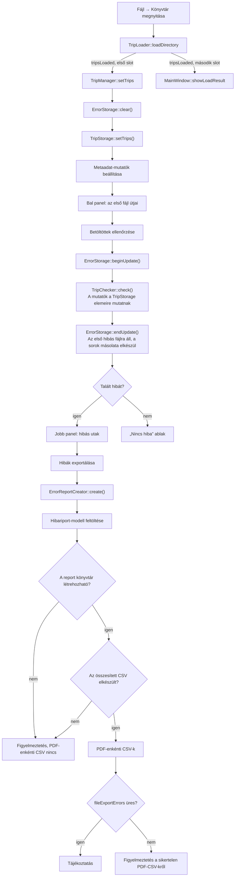
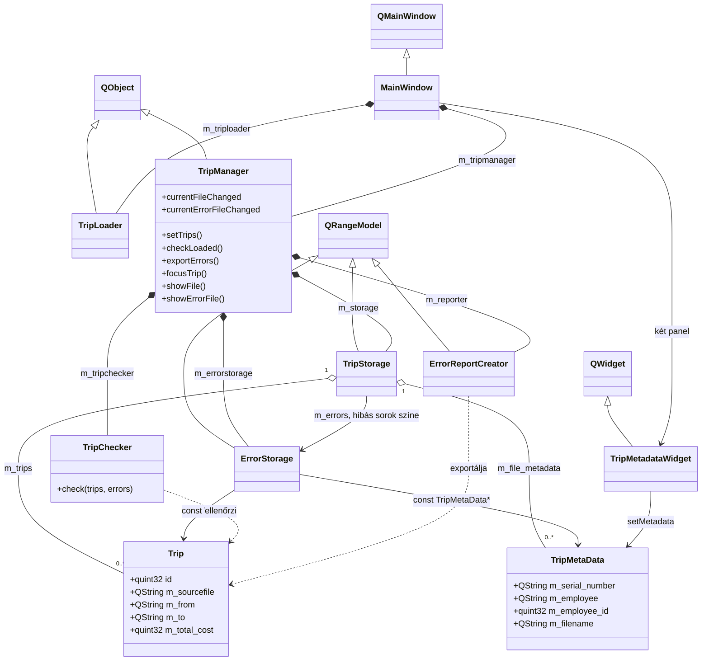
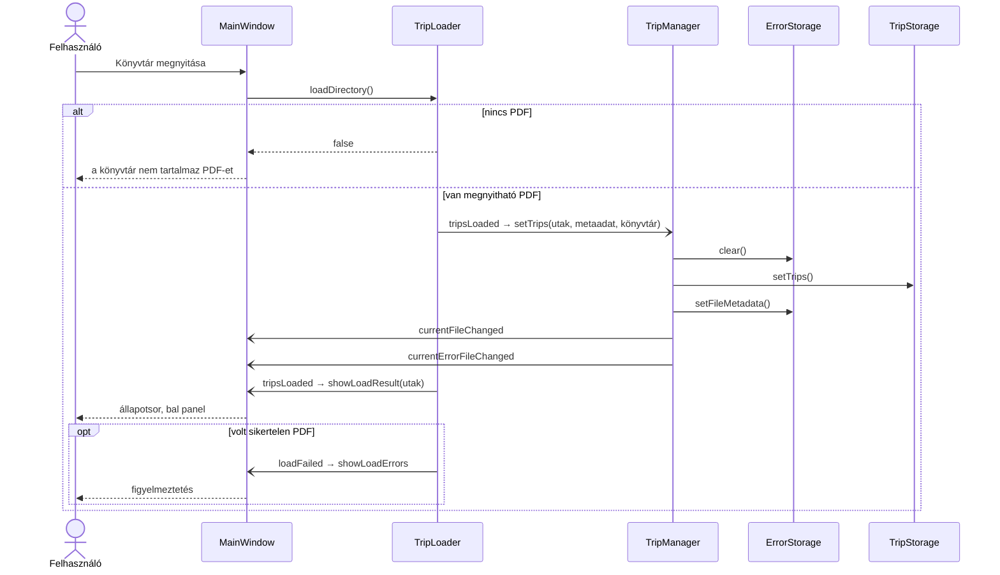
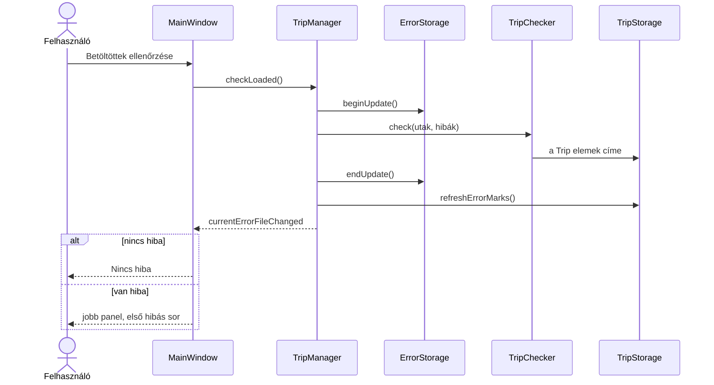
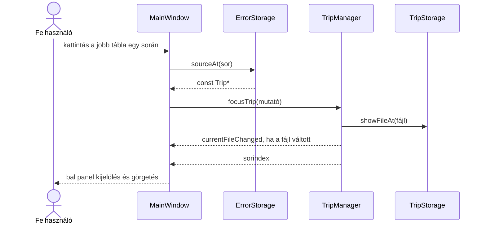
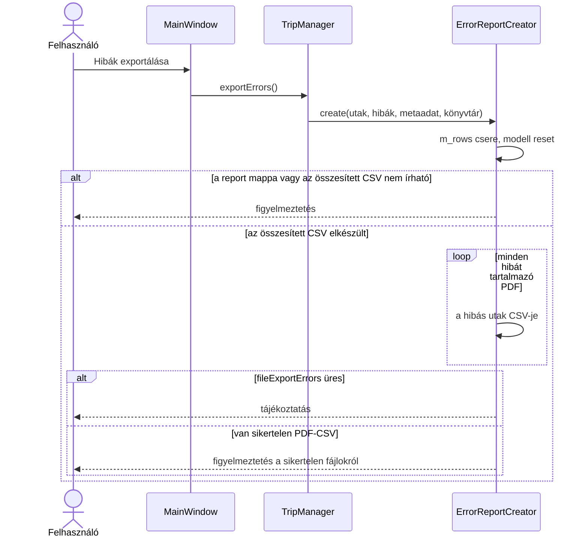

# Fejlesztői dokumentáció

A felhasználói leírás a [README.md](README.md). Ez a fájl a kód szerkezetét, az adatfolyamot és azokat a helyeket írja le, amelyeket együtt kell módosítani.

A program egy könyvtár PDF-jeiből kiküldetési rendelvényeket olvas, az utakat táblában mutatja, és hibának jelöli azokat, amelyeknél a kiindulópont és a cél megegyezik, az összköltség pedig nagyobb nullánál. Az ablak címe és a névjegyben szereplő név is **Kiküldetési Rendelvény Ellenőrző**. A CMake-cél és a futtatható állomány neve `KrEllenorzo`. A verziószöveg `v 0.9.0`. A verziószámot a `version.h` `inline constexpr uint` típusú `MAJOR`, `MINOR` és `PATCH` értéke adja, ebből állítja össze a névjegy. A CMake-projektnek nincs `PROJECT_VERSION` értéke.

## Fordítás

A kód C++23-at és a Qt 6.5-nél nem régebbi Widgets modult használ. A PDF-olvasás a `poppler-cpp` csomagon keresztül történik, pkg-configgal. A cél Qt a fejlesztői gépen a 6.11.1.

A [CMakeLists.txt](CMakeLists.txt) Windowsos gépen, ha nincs megadva toolchain, a `VCPKG_ROOT` vagy a `%USERPROFILE%/vcpkg` alatti `vcpkg.cmake` fájlt választja. Windows-hoszton a triplet alapértéke `x64-mingw-dynamic`. Ha a fordító MinGW, a tripletnek tartalmaznia kell a `mingw` szót, különben a konfiguráció hibával megáll. A Poppler pkg-config útvonala a vcpkg `installed/<triplet>/lib/pkgconfig` könyvtára. Ha a `pkg-config` nincs a PATH-on, a vcpkg letöltött MSYS2 fájának `mingw64/bin/pkg-config.exe` programját keresi.

Linuxon a rendszer pkg-configja találja meg a Popplert, a Qt-t pedig a használt kit adja. A Qt Creator build-könyvtárai például a `build/Desktop_Qt_6_11_1_Debug` és a `build/Desktop_Qt_6_11_1_Release`. A fordítás a projekt gyökeréből indul, és mindig egy konkrét build-könyvtárra vonatkozik. Debug példa:

```bash
cmake --build build/Desktop_Qt_6_11_1_Debug --parallel
```

A Release ugyanez a parancs a `build/Desktop_Qt_6_11_1_Release` könyvtárra.

Windowson a Poppler a vcpkg `poppler` portjából jön, a `poppler-cpp` pkg-config modullal. A Qt 6.5+ Widgets a Qt telepítéséből jön, a kit előtagjával. A `VCPKG_ROOT` legyen beállítva, a parancsok a projekt gyökerében futnak, a Qt útvonalát a saját kitre kell cserélni.

```bat
vcpkg install poppler --triplet x64-mingw-dynamic
cmake -S . -B build\windows -G "MinGW Makefiles" -DCMAKE_BUILD_TYPE=Release -DCMAKE_PREFIX_PATH=C:\Qt\6.11.1\mingw_64 -DVCPKG_TARGET_TRIPLET=x64-mingw-dynamic
cmake --build build\windows --parallel
cmake --install build\windows --prefix C:\kr-ellenorzo
```

A configure a toolchain fájlt a `VCPKG_ROOT` alapján veszi fel. A `poppler` port magával hozza a pkg-configot; ha az nincs a `PATH`-on, a CMake a vcpkg letöltött MSYS2 fájában keresi. Az install a binárist a megadott előtag `bin` könyvtárába teszi, és lefut a Qt telepítőszkript is.

A `qt_standard_project_setup()` a Qt 6.11-ben az `AUTOMOC` és az `AUTOUIC` kapcsolót állítja be, az `AUTORCC`-t nem. A [CMakeLists.txt](CMakeLists.txt) ezért külön bekapcsolja a `CMAKE_AUTORCC` kapcsolót. Enélkül az `icons.qrc` nem kerül a binárisba: az ablakikon üres marad, a súgó pedig a „A súgó nem tölthető be.” szöveget mutatja.

Az uic a `ui_mainwindow.h` fájlt a build-könyvtárba írja, és az idézőjeles `#include "tripmetadatawidget.h"` sort ebből a fájlból fordítja. A fordító ilyen include-nál nem a `.cpp` könyvtárában keres, ezért a forráskönyvtár a cél privát include-útvonalán van:

```cmake
target_include_directories(KrEllenorzo PRIVATE ${CMAKE_CURRENT_SOURCE_DIR})
```

Windowsos fordításkor az [app.rc](app.rc) az `icons/app.ico` fájlt köti a futtatható állományhoz. A `install()` a binárist a szokásos helyre teszi, a `qt_generate_deploy_app_script` pedig Qt-telepítő szkriptet készít. Automatizált tesztcél nincs.

## Rétegek

A betöltés, az állapot és a felület külön osztályban van.

| Szerep | Osztály | Felelősség |
| --- | --- | --- |
| Bemenet | `TripLoader` | Könyvtár bejárása, Poppler-olvasás, metaadat és utak előállítása |
| Állapot és koordináció | `TripManager` | A négy tagváltozó osztály (`TripStorage`, `ErrorStorage`, `TripChecker`, `ErrorReportCreator`) együttműködését vezérli; kezeli a fájlnavigációt és a hiba–forrás szinkront |
| Megjelenítés | `MainWindow` | Fülek, táblák, gombok, párbeszédablakok, súgó, névjegy |

A `TripManager` a kompozíció gyökere. A feladatokat a következő tagváltozó osztályokra bízza:

| Tagváltozó | Osztály | Szerep |
| --- | --- | --- |
| `m_storage` | **`TripStorage`** | A betöltött PDF-ek útjainak és metaadatainak tulajdonosa, valamint a bal oldali táblázat `QRangeModel` modellje. Nyilvántartja az aktuális fájlt és kezeli a bal oldali fájlnavigációt. |
| `m_errorstorage` | **`ErrorStorage`** | A hibás utakra mutató `const Trip *` mutatókat és a hozzájuk tartozó metaadat-mutatókat tárolja. A jobb oldali nézet `QRangeModel` modellje, és csak a hibát tartalmazó fájlok közötti navigációt kezeli. |
| `m_tripchecker` | **`TripChecker`** | A betöltött utakra alkalmazza a hibafeltételt, és fájlonként feltölti az `ErrorStorage` hibalistáját. Sima C++ osztály, nem `QObject`. |
| `m_reporter` | **`ErrorReportCreator`** | A Hibariport fül `QRangeModel` modellje. A kiszámolt hibákból felépíti a riportsorokat, majd elkészíti az összesített és a PDF-enkénti CSV-fájlokat. |

A manager határozza meg a műveletek sorrendjét és az objektumok közötti adatáramlást. Az ellenőrzés és az export közvetlen metódushívás, nincs belső signal a manager és a `TripChecker` vagy az `ErrorReportCreator` között. A manager csak két signalt bocsát ki, mindkettőt a felületnek: `currentFileChanged` és `currentErrorFileChanged`.

A betöltés és az ellenőrzés a felület szálán fut. A várt könyvtárméret mellett a feldolgozás rövid, ezért nincs háttérszál és folyamatjelző.



### Osztálydiagram

A `TripChecker` nem származik a `QObject` osztályból. A három modell a `QRangeModel` leszármazottja. A hibamutatók a `TripStorage` tulajdonában lévő `Trip` elemekre mutatnak.



### Szekvenciadiagramok

A betöltés a felület szálán fut. A nyitott nyíl signal: a `tripsLoaded` egy kibocsátás, két slotra kötve, a `connect()` sorrendjében. A `MainWindow` nem hívja a `setTrips()` függvényt. A hibák törlése megelőzi az utak cseréjét.



Az ellenőrzés szinkron: a `check()` a `beginUpdate()` és az `endUpdate()` között tölti a mutatólistát.



A hibasor kiválasztása cím szerint keres, nem az út azonosítója szerint.



Az export először a Hibariport modelljét tölti fel. A PDF-enkénti CSV csak az összesített fájl sikeres írása után indul. A záró ablak fajtáját a `fileExportErrors` lista dönti el.



## Fájlok

- [trip.h](trip.h) — egy út tizenhárom mezője és a tuple-protokoll.
- [tripmetadata.h](tripmetadata.h) — egy PDF fejléce: sorszám, munkavállaló, törzsszám, fájlnév.
- [columnheaders.h](columnheaders.h) — a táblák és a CSV-k közös fejlécei.
- [triploader.h](triploader.h), [triploader.cpp](triploader.cpp) — Poppler-parser.
- [tripstorage.h](tripstorage.h), [tripstorage.cpp](tripstorage.cpp) — a betöltött fájlok és a bal tábla modellje.
- [errorstorage.h](errorstorage.h), [errorstorage.cpp](errorstorage.cpp) — a hibák és a jobb nézet modellje.
- [tripchecker.h](tripchecker.h), [tripchecker.cpp](tripchecker.cpp) — az ellenőrzési szabály.
- [errorreportcreator.h](errorreportcreator.h), [errorreportcreator.cpp](errorreportcreator.cpp) — a Hibariport modellje és a CSV-írás.
- [tripmetadatawidget.h](tripmetadatawidget.h), [tripmetadatawidget.cpp](tripmetadatawidget.cpp) — a négy metaadatcímke.
- [mainwindow.h](mainwindow.h), [mainwindow.cpp](mainwindow.cpp), [mainwindow.ui](mainwindow.ui) — a felület.
- [icons.qrc](icons.qrc) — az alkalmazásikon és a súgó szövege.

## Út adatsémája

A `Trip` mezői és a `tripColumnHeaders()` sorrendje ugyanaz. A `std::tuple_size<Trip>` értéke 13. A `get<I>()` mindig konstans referenciát ad vissza, a nézetek tehát csak olvassák a sort.

| Index | Mező | Fejléc | Látható a két ellenőrző nézetben |
| --- | --- | --- | --- |
| 0 | `id` | Azonosító | igen |
| 1 | `m_sourcefile` | Forrásfájl | nem |
| 2 | `m_trip_date_begin` | Kezdés | nem |
| 3 | `m_trip_date_end` | Befejezés | nem |
| 4 | `m_purpose` | Cél | nem |
| 5 | `m_from` | Honnan | igen |
| 6 | `m_to` | Hova | igen |
| 7 | `m_length` | Távolság | igen |
| 8 | `m_fuel_price` | Üzemanyagár | nem |
| 9 | `m_fuel_cost` | Üzemanyagköltség | nem |
| 10 | `m_maintenance_cost_factor1` | Fenntartási szorzó 1 | nem |
| 11 | `m_maintenance_cost_factor2` | Fenntartási szorzó 2 | nem |
| 12 | `m_total_cost` | Összesen | igen |

A látható oszlopok a `mainwindow.cpp` `kVisibleColumns` tömbjében vannak: `{0, 5, 6, 7, 12}`. A Hibariport minden riportoszlopot mutat. A fejlécek fordítási kontextusa `ColumnHeaders`. A `reportColumnHeaders()` a négy metaadat-fejlécet (`Fájlnév`, `Sorszám`, `Munkavállaló`, `Törzsszám`) fűzi a túrafejlécek elé.

Ha a PDF-séma bővül, együtt kell módosítani a `Trip` mezőit, a `get<I>()` ágait, a `tuple_size` értékét és a `tripColumnHeaders()` listáját. A [triploader.cpp](triploader.cpp) ebből a szövegből tölti a mezőket: a `columnOf`, a `fillText`, a `fillAmounts` és a `readMetadata` a PDF felismerése, nem a CSV sora. A CSV-be írt mezőket az [errorreportcreator.cpp](errorreportcreator.cpp) `tripFields()` függvénye adja, a fejlécekkel azonos sorrendben. Ha az új mezőnek látszania kell az ellenőrző nézeteken, a `kVisibleColumns` tömböt is bővíteni kell.

A `QRangeModel` a konstruktorban `std::ref(m_rows)` hivatkozást kap. A konstruktor nem olvassa a tartományt, ezért a tagváltozó még üres lehet. A `m_rows` tartalmát csak `beginResetModel()` és `endResetModel()` között szabad cserélni.

A modellnek mozgatható elemek kellenek. A `QVector<const Trip *>` használható. A `QVector<const Trip * const>` nem: a Qt az elemet `void *` célba helyezi, a konstans elem pedig nem alakítható át így.

## PDF-olvasás

A `TripLoader::loadDirectory` csak a kijelölt könyvtár közvetlen fájljait nézi, név szerint, kis- és nagybetűt figyelmen kívül hagyva. Almappába nem megy. A `.pdf` kiterjesztést kis- és nagybetűtől függetlenül fogadja el. Ha egy fájl kivételt dob, kimarad a betöltött listából, a hibaüzenet pedig a `loadFailed` signalon megy a felületre. Ha egyetlen PDF sincs, a függvény `false` értéket ad, és nem bocsát ki `tripsLoaded` signalt. A felület ekkor közli, hogy a könyvtár nem tartalmaz PDF-et.

A szövegdobozokat a Poppler `text_list()` adja. A szó X-koordinátája a doboz bal éle, az Y a függőleges közép. A `kLineTolerance` értéke 3 pont: az ennél közelebbi Y-ú szavak egy sorba kerülnek, majd a soron belül X szerint rendeződnek.

Egy új út ott kezdődik, ahol az azonosítóoszlopban (`x < 52`) olyan token áll, amely számjegyekből áll és ponttal végződik, például `12.`. A további, azonosító nélküli sorok a szövegmezőket folytatják. Az összegeket csak az azonosító sora tölti be, a számjegyek összefűzésével. Üres számmező 0.

Az oszlophatárok pontban, a szó bal szélétől:

| X alsó határ | Oszlop |
| --- | --- |
| 0 | Azonosító |
| 52 | Kezdés |
| 100 | Befejezés |
| 148 | Cél |
| 200 | Útvonal |
| 310 | Távolság |
| 345 | Üzemanyagár |
| 390 | Üzemanyagköltség |
| 430 | Fenntartási szorzó 1 |
| 460 | Fenntartási szorzó 2 |
| 490 | Összesen |

Az útvonaloszlopban az `Innen` jelölő a kiindulópontot, az `Ide` jelölő a célt nyitja. A jelölő és az érték egy tokenben is állhat (`Innen:`). A következő szavak addig az aktuális részhez tartoznak, amíg a másik jelölő meg nem jelenik. A vessző, a pont, a pontosvessző és a kettőspont szóköz nélkül tapad az előző szóhoz.

A metaadat csak az első oldalról készül.

- A sorszám a `sorszám` vagy `sorszám:` címke alatti első nem üres sor, mindkettő `x > 450` feltétellel. A címke és az érték közötti címkesor üresnek számít, ha nincs benne ilyen X-ű szó.
- A munkavállaló neve az első `neve` vagy `neve:` címke jobb oldalán álló szavak. A címke X-e 200 és 330 között van, az érték a címke X-énél legalább 40 ponttal jobbra kezdődik.
- A törzsszám a `törzsszáma` előtagú szótól jobbra álló számjegyek, `quint32` értékként. Ha nincs számjegy, az érték 0.
- A `m_filename` a `QFileInfo::fileName()` eredménye, tehát tartalmazza a `.pdf` kiterjesztést. A `m_sourcefile` a teljes útvonal.

A parser egy rögzített rendelvényelrendezést olvas. Más elrendezésű PDF-nél az oszlopok és a fejlécmezők elcsúsznak. Nincs általános táblafelismerés.

## Tárolás és ellenőrzés

A `TripStorage` minden betöltött fájlt a `m_trips` vektorban tart. A `m_rows` a bal tábla aktuális fájljának másolata. A `m_file_metadata` fájlonként egy `TripMetaData`. A `m_trip_meta_data` ennek a vektornak az aktuális eleméről készült másolat, ezt mutatja a bal `TripMetadataWidget`. A bal előző és következő gomb, valamint a `currentFileCombo` minden betöltött fájlon végiglép, a hibátlanokon is. A lista választása a `TripManager::showFile()` slotot hívja. Az üres útjú, de sikeresen megnyitott fájl is a listában marad.

Az `ErrorStorage::m_triperrors` típusa `QVector<QVector<const Trip *>>`. A mutatók a `TripStorage::m_trips` elemeire mutatnak, nem a megjelenített másolatokra. Az azonosítók ütközhetnek, ezért a jobb sorból a bal sorra ugrás a mutató címét hasonlítja össze, nem az azonosítót. A jobb tábla `m_rows` vektora ezeknek a `Trip` objektumoknak a másolata, hogy a `QRangeModel` a tuple-oszlopokat meg tudja jeleníteni. Egy mutatóvektorból a `Trip` oszlopai nem jönnének ki.

Az `ErrorStorage::m_file_metadata` konstans mutatókat tárol a `TripStorage` metaadat-vektorába. A `setTrips` először törli a hibákat, utána lecseréli az utakat, és csak ezután állítja be a mutatókat. Így a mutatók nem a signal argumentumának ideiglenes vektorába mutatnak. Új betöltés előtt a `clear()` eldobja a mutatókat és a hibasorokat. Ellenőrzés után a forráskonténert nem szabad átrendezni, mert a hibamutatók érvénytelenné válnának.

A `TripChecker::check` a kimeneti vektort a fájlok számával azonos méretűre állítja, fájlonként üres belső vektorral. Egy út akkor hiba, ha `m_from == m_to` és `m_total_cost > 0`. A `checkLoaded` a `beginUpdate()` és az `endUpdate()` között hívja. A hívásnak szinkronnak kell maradnia: az `endUpdate` a már kitöltött vektorból építi a látható sorokat, és az első nem üres hibafájlra áll. Utána a `TripStorage::refreshErrorMarks()` `dataChanged` signalt küld a bal tábla soraira. A `TripStorage` a `TripManager` konstruktorában kapja meg az `ErrorStorage` konstans mutatóját. A nézet a szerepeket a `multiData()` függvényen kéri. A `QRangeModel::multiData()` nem hívja a virtuális `data()` függvényt, ezért a színezést a `TripStorage::multiData()` írja a `BackgroundRole` és a `ForegroundRole` mezőbe, `QBrush` értékként. A `data()` ugyanezt adja vissza. A döntés az `ErrorStorage::isError()` eredménye: a hibás sor háttere piros, a szövege fekete. Az összevetés a `m_trips` elemének címével történik, nem a megjelenített másolatéval. Fájlváltáskor a modell-reset újraszámolja a színeket, új betöltéskor a hibák törlése eltünteti őket. A jobb előző és következő gomb, valamint a `currentErrorFileCombo` a nullmutatóktól és az üres fájloktól eltekintve lép. A lista választása a `TripManager::showErrorFile()` slotot hívja. A jobb fájlnév a `TripStorage::fileNameAt` eredménye, üres útjú fájlnál a metaadat `m_filename` mezője.

A jobb tábla `clicked` és `currentRowChanged` signalja is a `showSelectedError` slotot hívja. A `currentRowChanged` az aktuális sor újbóli kattintására nem fut le, a `clicked` igen. A `focusTrip` megkeresi a mutatót, szükség esetén fájlt vált a bal panelen, és visszaadja a sorindexet. A felület kijelöli a sort, és középre görgeti.

## Felület

Két fül van. Az **Ellenőrzés** a vízszintes splittert tartalmazza, a **Hibariport** a riporttáblát.

A két panel vízszintes méretpolitikája `Ignored`, a stretchük egyenlő, a splitter fogantyúja le van tiltva. Az `equalizePanes()` megjelenítéskor, átméretezéskor és fülváltáskor felezi a rendelkezésre álló szélességet. A táblák kitöltik a paneljüket.

A könyvtárablak `QFileDialog::Directory` módban nyílik. A `ShowDirsOnly` értéke a `setFileMode` után `false`, különben a Qt visszaállítja. A `DontUseNativeDialog` be van kapcsolva, a névszűrő `PDF fájlok (*.pdf)`. Így a mappák böngészhetők, a nem PDF fájlok pedig rejtve maradnak.

A `TripMetadataWidget` a négy címkét mindkét panelen ugyanúgy rajzolja: középre igazított, tördelhető szöveg. A `setMetadata({})` üres állapotot mutat. A két panel fájlneve `QComboBox`: a `currentFileCombo` minden betöltött fájlt kínál, a `currentErrorFileCombo` csak a hibát tartalmazókat. A választás az `activated` signalon megy a `showFile()` és a `showErrorFile()` slotra, ezért a lista programozott frissítése nem vált fájlt újra. A piros, félkövér stílus a bal listán jelenik meg, ha a két panel fájlneve eltér. A metaadat „Fájlnév” címkéje nem kap ilyen stílust.

A **Betöltöttek ellenőrzése** gomb akkor aktív, ha legalább egy fájlban van út. A **Hibák exportálása** akkor aktív, ha bármely fájlban van nem null hibamutató. Ha az ellenőrzés nem talál hibát, információs ablak jelenik meg. Ha talál, a jobb tábla az első hibás sorra ugrik.

A három nézet `QTableView`, közös beállításuk a `configureTripView`. A bal a `tripTable`, a jobb az `errorTable`, a riport a `reportTable`. A `WrappingItemDelegate` a tördelt szöveget középre rajzolja, és 2 pontos rácsot fest. A jobb tábla és a riport fejléce félkövér. Az oszlopok interaktívak, az utolsó szakasz nyúlik. Szakaszátméretezéskor és az oszlopok beállítása után a tábla `resizeRowsToContents()` hívást kap, a sormagasság a tördelt szöveghez igazodik. Az oszlopszélesség alsó határa a fejléc mérete plusz 12 pont. A felső határ `qMax(minimum, 280)`: ha a fejléc 12 ponttal együtt 280 alatt marad, az oszlop legfeljebb 280 pontos, hosszabb fejlécnél a felső határ a minimummal együtt 280 fölé nő. A riport ugyanezt a számítást minden oszlopára alkalmazza, modell-resetkor és induláskor.

## Export

Az `ErrorReportCreator::create` publikus metódus, nem slot. Először felépíti a riportsorokat, és `beginResetModel` / `endResetModel` között lecseréli a `m_rows` tartalmát. A Hibariport fül ettől kezdve a sorokat mutatja akkor is, ha a fájlírás később meghiúsul.

A szülő widgetet a `QObject::parent()` láncon keresi. A `QRangeModel::parent(QModelIndex)` elrejti a `QObject::parent()` függvényt, ezért a minősített hívás kell.

A célkönyvtár a betöltött könyvtár `report` almappája. Ha a mappa nem hozható létre, figyelmeztetés jelenik meg, és a metódus visszatér. Az összesített fájl neve `report_yyyy_MM_dd_HH-mm.csv`. Az időbélyeg kötőjelet használ, kettőspontot nem. A fájl UTF-8, BOM-mal, az idézőjeles mezőket megduplázott idézőjel védi. A fejléce a `reportColumnHeaders()`, a sorok a hibás utak, elöl a négy metaadattal. A megnyitás és a stream írása külön figyelmeztetést ad, és ilyenkor a PDF-enkénti export el sem kezdődik.

A PDF-enkénti CSV csak azokat a fájlokat tartalmazza, amelyeknek van legalább egy nem null hibamutatója. A tartalma a hibás utak, fejléce a `tripColumnHeaders()`, metaadatoszlopok nélkül. A fájlnév `Munkavállaló_neve-forrásfájl.csv`: a szóközök aláhúzásjelek, a forrásnév a `completeBaseName()`, tehát a `.pdf` kiterjesztés nincs benne. Egy fájl írási hibája nem állítja meg a többit. A hibák a `fileExportErrors` listába kerülnek.

A záró ablak ettől a listától függ.

- Üres lista: információs ablak, az összesített fájl útvonalával, és azzal, hogy a hibás PDF-ek CSV-je a `report` mappába került.
- Nem üres lista: egy figyelmeztetés. Közli, hogy az összesített riport elkészült, és felsorolja a sikertelen fájlokat. Sikerüzenet utána nem jelenik meg.

## Súgó és névjegy

Az [icons.qrc](icons.qrc) a `:/icons/app.png` ikont és a `:/help/readme.md` aliast tartalmazza. Az alias a [README.md](README.md) fájlra mutat, ezért a súgó a használati leírással együtt frissül, ha a program újrafordul. Az **F1** és a **Súgó** menü ugyanazt a nem modális ablakot nyitja. A `QTextBrowser::setMarkdown` rajzolja ki. Az ablak a bezárásig megmarad, ismételt megnyitáskor előre kerül.

A **Névjegy** a súgó alatt, elválasztó után van. A szöveg középre igazított: a terméknév, a `version.h` értékeiből összeállított `v MAJOR.MINOR.PATCH`, a készítő neve és az e-mail-címe. A doboz a főablak ikonját mutatja.

## Tudatosan vállalt kompromisszumok

Ezek a lehetőségek felmerültek, és szándékosan nem készültek el. A helyükön a következő korlátok maradtak.

### Általános PDF-feldolgozás

Felmerült, hogy a beolvasó ismerje fel a táblát, és több rendelvényváltozatot is fogadjon. Ez nem készült el. A cél egy rögzített dokumentumelrendezés, ennek a formátumát kézzel ellenőrizni rövid és egyértelmű.

A vállalt korlát: a [triploader.cpp](triploader.cpp) koordinátákra és a `sorszám`, `neve`, `törzsszáma`, `Innen`, `Ide` feliratokra épül. Más elrendezésnél a mezők elcsúsznak. Nincs formátumfelismerés és nincs általános táblakinyerés.

### Nyitott oszlopkészlet az ellenőrző nézeteken

Felmerült, hogy a bal és a jobb nézet a séma minden mezőjét mutassa, vagy a látható oszlopokat a felhasználó válassza ki. Ez nem készült el.

A vállalt korlát: a `kVisibleColumns` értéke `{0, 5, 6, 7, 12}`, vagyis azonosító, honnan, hova, távolság és összesen. Az indexek egy zárt, stabil sémára épülnek. A többi mező a modellben és a CSV-ben megvan, az ellenőrző felületen rejtett.

### Egyetlen generált mezőleképezés

Felmerült, hogy a `Trip` mezői, a tuple-protokoll, a fejlécek és a CSV-sor egy definícióból keletkezzenek. Generátor vagy makró nem készült.

A vállalt korlát: a `Trip::get<I>()`, a `tripColumnHeaders()` és az `errorreportcreator.cpp` `tripFields()` függvénye együtt alkotja a leképezést. A sorrendjüknek egyeznie kell. Dokumentumformátum-változáskor mindhárom helyet kézzel kell módosítani, a látható oszlopok indexeivel együtt.

### Önálló hibarekord azonosítóval

Felmerült, hogy az `ErrorStorage` saját út-példányokat vagy stabil azonosítókat tároljon, és a bal panelre ugrás ne függjön a forráskonténer címétől. Ez nem készült el. A megjelenített sor másolat, de a kiválasztás kulcsa a mutató.

A vállalt korlát: az `ErrorStorage` `const Trip *` mutatókat tart a `TripStorage` elemeire. Új betöltéskor a hibák törlése megelőzi az utak cseréjét. Ellenőrzés után a forráskonténer nem módosul, nem rendeződik át, és nem nő újra, mert a mutatók akkor érvényüket vesztenék. Az út `id` mezője nem azonosító a fájlok között, ezért összekapcsolásra nem használható.

### Háttérszál és folyamatjelzés

Felmerült, hogy a PDF-olvasás és az ellenőrzés a felület szála mellett, megszakítható munkaszálon fusson, folyamatjelzővel. Ez nem készült el.

A vállalt korlát: a `TripLoader::loadDirectory` és a `TripChecker::check` a felület szálán, blokkolva fut. A célzott könyvtárméret mellett a feldolgozás rövid. Nagy könyvtárnál az ablak a betöltés végéig nem fogad eseményt.

## Amikor a formátum vagy a szabály változik

A [vállalt kompromisszumok](#tudatosan-vállalt-kompromisszumok) határai továbbra is érvényesek: a parser rögzített elrendezést olvas, a látható oszlopok zártak, a három leképezés kézi, a hibák mutatók, a munka a felület szálán fut.

1. Oszlop vagy mező: a [séma táblája](#út-adatsémája) minden felsorolt helye.
2. Koordináta vagy fejlécfelirat a PDF-ben: a `columnOf`, a `readMetadata` és az `Innen` / `Ide` feldolgozás a [triploader.cpp](triploader.cpp) fájlban.
3. Hibafeltétel: kizárólag a `TripChecker::check`. A felület és az export a már kiszámolt mutatólistát használja.
4. Új látható oszlop az ellenőrző nézeteken: a `kVisibleColumns`. A riport ettől függetlenül a teljes fejlécet mutatja.
5. CSV-oszlop vagy fájlnév: az `errorreportcreator.cpp` névtelen névterében a `tripFields`, a `reportRow`, a `csvFileName` és a `sourceFileName`. A felhasználói mondatot a [README.md](README.md) Hibariport szakaszában is át kell írni, mert a súgó onnan olvas.
